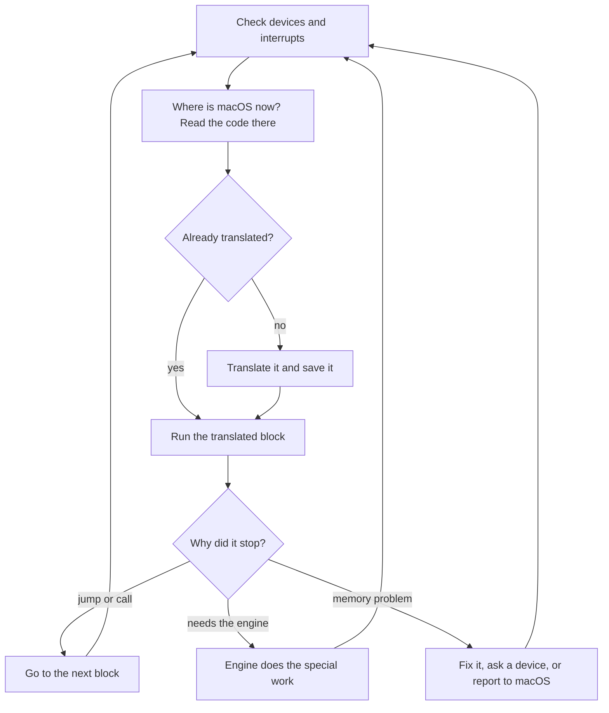

# Dispatch Loop

The engine's main loop. Almost everything Stela does while macOS runs starts here. Source: `crates/stela-engine/src/machine/engine.rs` and `engine/scheduler.rs`.

## The code cache
Translated blocks are stored in memory so they are only translated once. This store is the **code cache**.

One detail: the same Mac code can need *different* translations depending on the situation, for example whether it runs as an app or as the kernel, or which safety checks are switched on. So the cache key is "address **plus** situation", not just the address.

## Files to know
| File | Job |
|---|---|
| `fetch.rs` | Find and read the code to run |
| `compilation.rs` | Call the translator and store the result |
| `code_cache.rs` | Throw away translations that are no longer valid |
| `stored.rs` | Load translations saved by an earlier boot |
| `recovery.rs` | Work out exact register values after something went wrong mid-block |
| `device_access.rs` | Pass reads and writes to pretend devices |
| `interrupts.rs` | Deliver interrupts; handle "wait until something happens" |

## When the cache gets full or stale
- **Full:** the oldest translations are dropped to make room.
- **Stale:** if macOS overwrites memory that held code, translations of that code are deleted so the new code gets translated.

Related: [[Life of an Instruction]], [[Translator Fast Paths]], [[Shadow Paging]].
