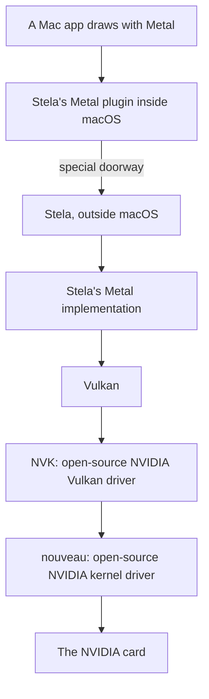

# GPU and Metal

## The problem
Everything macOS draws goes through **Metal**, Apple's graphics programming interface. Metal expects an Apple graphics chip. A PC has an NVIDIA card, which speaks a completely different language.

## Stela's approach
Stela does not imitate Apple's graphics chip. It plugs **its own Metal driver** into macOS. That driver forwards every graphics request out of macOS to Stela, which runs it on the NVIDIA card.

**Vulkan** is an open graphics interface, similar in purpose to Metal. Stela translates Metal requests into Vulkan requests, and existing open-source drivers handle the rest.

## The pieces
| Piece | Where | Runs |
|---|---|---|
| Kernel part (kext) | `guest/stela-gpu/kext/` | Inside macOS |
| Metal plugin | `guest/stela-gpu/bundle/` | Inside macOS apps |
| The doorway | `crates/stela-soc/src/gpu_gate.rs` | A pretend device |
| Metal implementation | `crates/stela-driver-gpu/src/metal/` | In `stela.efi` |
| NVK | `crates/stela-mesa`, `third_party/mesa` | In `stela.efi` |
| nouveau | `third_party/linux`, via [[Linux Environment]] | In `stela.efi` |

## Inside the Metal implementation
One file per Metal concept: `resource.rs` (textures and buffers), `pipeline.rs`, `command_buffer.rs` (lists of drawing commands), `sampler.rs`, `pixel_format.rs`.

## Honest feature reporting
Apps ask Metal "can you do X?". Stela says yes only if **all three** layers can do it: the NVIDIA driver, the shader translator, and Stela's Metal code. Otherwise it records which layer is missing the feature (`metal/capabilities.rs`).

> [!info] Only NVIDIA for now
> The README lists NVIDIA GTX 16 and RTX 20 to 50 series.

Next: [[Metal Call Path]], [[Shader Compilation]].
