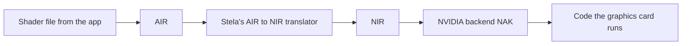

# Shader Compilation

## What is a shader?
A **shader** is a small program that runs on the graphics card, for example to compute the color of each pixel. Apps ship shaders with their code.

## The problem
Mac apps ship shaders in Apple's format, called **AIR**. The NVIDIA driver stack needs them in its own format, **NIR**. Neither is readable text; both are *intermediate representations* — halfway forms between source code and machine code.

## The solution
Stela includes a translator from AIR to NIR. This is a second translator in the project, separate from the CPU one in [[Translator Overview]].



## Where the code is
| Step | Where |
|---|---|
| Open Apple's shader file | `crates/stela-driver-gpu/src/metal/library.rs` |
| Translate AIR to NIR (written in C) | `crates/stela-driver-gpu/src/compiler/` |
| Rust wrapper around it | `crates/stela-driver-gpu/src/metal/compiler.rs` |
| Turn NIR into card code | NAK, part of the Mesa project |

AIR is built on **LLVM**, a widely used compiler toolkit. So Stela includes LLVM to read it. Apple's shader file format is not officially documented; the reader checks every size and offset before trusting it.

## Compiling can be slow
A shader may take a noticeable moment to compile. To avoid freezing, the request returns "not ready yet", and the compile runs in the background on another CPU core (`metal/deferred.rs`).

Results are also saved and reused, like CPU translations.

## Testing without a graphics card
```
cargo xtask gpu compilers
```
builds the shader translator for your own computer and runs its tests. It only checks translation; nothing is drawn.

> [!info] A big dependency
> LLVM and Mesa are both built into `stela.efi`. This is the main reason the first build takes so long.

Related: [[GPU and Metal]], [[Metal Call Path]], [[Build and Check]].
