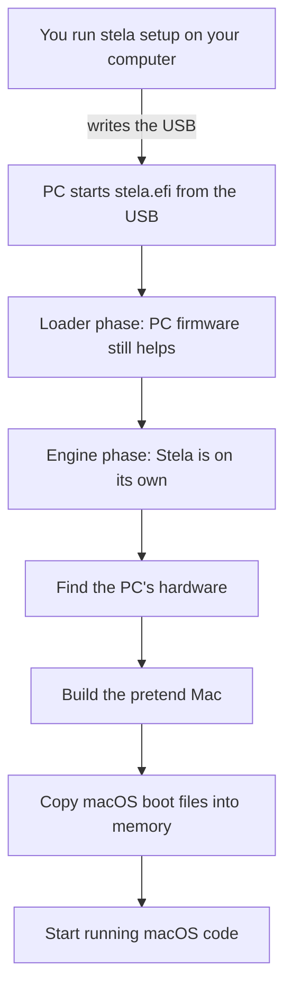

# Life of a Boot

What happens from "plug in the USB" to "macOS is running".

## Step by step
1. **Setup.** On your normal computer, `stela setup` writes everything needed to a USB stick. See [[Setup and USB]].
2. **The PC starts Stela.** Every PC has built-in startup software called *firmware* (UEFI). It finds `stela.efi` on the USB and runs it.
3. **Loader phase.** Stela reads its settings, grabs memory and prepares. The firmware is still available to help, for example to read files. See [[Loader Phase]].
4. **Stela takes over.** Stela tells the firmware "I'll handle everything now". After that, Stela must do everything itself, including reading disks.
5. **Engine phase.** Stela finds the PC's real hardware, builds the pretend Mac hardware, and loads macOS's boot files. See [[Engine Phase]].
6. **macOS runs.** Stela starts translating and running macOS code. See [[Life of an Instruction]].

## What macOS notices
Nothing unusual. It starts exactly as it would on a real Mac: same starting point, same list of hardware, same boot files. That is the goal. See [[Boot Bundle]] and [[Machine Model]].

> [!tip] You can try this without a spare PC
> `cargo xtask boot run` starts Stela inside QEMU, a program that simulates a PC. See [[QEMU Runs]].

Next: [[Life of an Instruction]].
