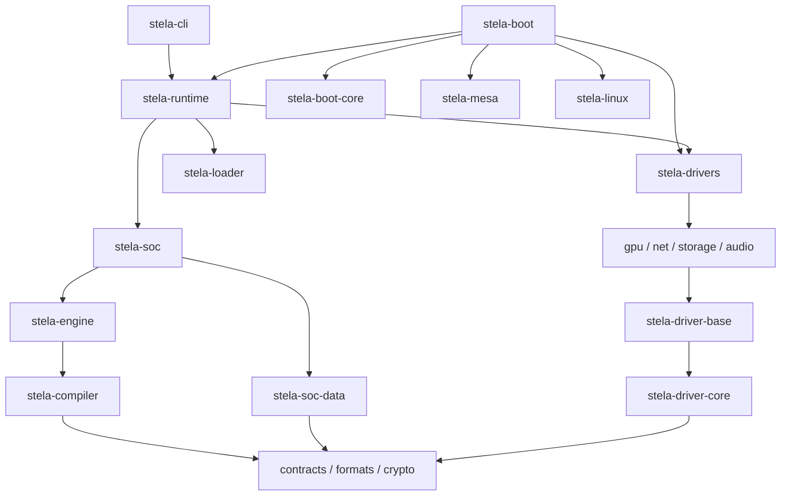

# Dependency Shape

Which crate uses which. An arrow means "uses". Lower crates know nothing about the ones above them.

The diagram is simplified. Each crate's `Cargo.toml` has the exact list.

## Two things worth remembering
**1. The engine is kept "pure".** It does not know about PCs or Apple devices. It defines two interfaces and lets other crates fill them in:
- `Host` — "the real computer" — filled in by `stela-boot`
- `Devices` — "the pretend Mac hardware" — filled in by `stela-soc`

See [[Host and Devices Traits]].

**2. Most crates work with and without an operating system.** The same code runs inside `stela.efi` on a bare PC, and inside tests on your laptop. In Rust terms: they are `no_std`, with an optional `std` feature.

> [!tip] Why this is good for you
> You can test most of Stela on your own computer with `cargo test`. See [[Build and Check]].

Related: [[Repo Map]], [[Engine Overview]].
